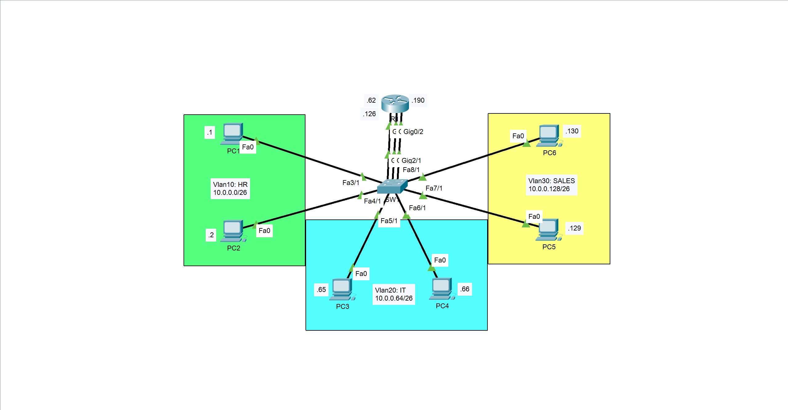

# Simple Inter-VLAN Routing — Physical Interfaces

A Cisco Packet Tracer lab demonstrating inter-VLAN routing using dedicated physical router interfaces, VLAN segmentation, IPv4 subnetting, and end-to-end connectivity verification.

## Overview

This lab demonstrates how a router can enable communication between multiple VLANs by assigning a dedicated physical interface to each VLAN.

Unlike Router-on-a-Stick, this approach does not use router subinterfaces or an 802.1Q trunk between the router and the switch. Each router interface connects to a switch access port assigned to the corresponding VLAN.

The lab uses three VLANs representing different departments: Human Resources (HR), Information Technology (IT), and Sales.

## Objectives

- Create and name VLANs on a Layer 2 switch.
- Assign switch access ports to the appropriate VLANs.
- Configure dedicated physical router interfaces for each VLAN.
- Apply IPv4 addressing and subnetting using `/26` networks.
- Configure end-device IP addresses and default gateways.
- Understand how a router forwards traffic between different IP networks.
- Verify interface status, routing-table entries, VLAN membership, and end-to-end connectivity.

## Network Topology



The topology consists of:

- 1 Cisco router (R1)
- 1 Cisco switch (SW1)
- 6 end devices (PCs)
- 3 VLANs and 3 IPv4 subnets
- 3 dedicated physical router interfaces

Each VLAN connects to R1 through its own physical interface. The corresponding switch port operates in access mode and belongs to that VLAN.

## VLANs and IPv4 Addressing

The address space `10.0.0.0/24` is divided into four `/26` subnets. Three of these subnets are used in this lab.

| VLAN | Department | Network | Subnet Mask | Default Gateway |
|---|---|---|---|---|
| 10 | HR | `10.0.0.0/26` | `255.255.255.192` | `10.0.0.62` |
| 20 | IT | `10.0.0.64/26` | `255.255.255.192` | `10.0.0.126` |
| 30 | SALES | `10.0.0.128/26` | `255.255.255.192` | `10.0.0.190` |

Each `/26` subnet provides 62 usable host addresses. The last usable address is assigned to the router interface acting as the default gateway for that VLAN.

## Routing Design

Each VLAN uses a dedicated physical interface on R1:

| Router Interface | Connected Network | Gateway |
|---|---|---|
| `G0/0` | `10.0.0.0/26` | `10.0.0.62` |
| `G0/1` | `10.0.0.64/26` | `10.0.0.126` |
| `G0/2` | `10.0.0.128/26` | `10.0.0.190` |

The switch ports connected to the router are configured as access ports in their respective VLANs. No trunk link or router subinterfaces are required.

Because the three networks are directly connected to R1, Cisco IOS automatically installs the corresponding connected routes in the routing table.

## Configuration Files

The repository includes the following device configurations:

- [`configs/R1-config.txt`](configs/R1-config.txt) — router interface addressing and gateway configuration.
- [`configs/SW1-config.txt`](configs/SW1-config.txt) — VLAN creation and access-port assignments.

## Verification and Testing

The lab includes verification evidence for:

- Router interface status and IPv4 addressing using `show ip interface brief`.
- Connected routes using `show ip route`.
- VLAN creation and port membership using `show vlan brief`.
- Trunk status using `show interfaces trunk`.
- End-to-end connectivity tests between end devices in different VLANs.

See the [`tests/`](tests/) directory for the captured connectivity results, simulation evidence, and CLI output.

The expected result is successful communication between devices in different VLANs through R1, provided that their IP addresses, subnet masks, default gateways, and VLAN assignments are correct.

## Repository Structure

```text
Simple-Inter-VLANs-Routing/
├── configs/
│   ├── R1-config.txt
│   └── SW1-config.txt
├── docs/
│   ├── documentation.md
│   └── topology.png
├── src/
│   └── Simple-Inter-VLANs-Routing.pkt
├── tests/
│   ├── end-to-end-connectivity.png
│   ├── simulation-mode.png
│   └── shows.txt
├── .gitignore
├── LICENSE
└── README.md
```

## Key Takeaways

- VLANs provide logical Layer 2 segmentation.
- Inter-VLAN communication requires Layer 3 routing.
- Each VLAN must have a valid default gateway in its own subnet.
- Dedicated physical router interfaces provide a straightforward way to route between VLANs.
- This approach consumes one router interface per VLAN and is therefore less scalable than Router-on-a-Stick or multilayer switching.

## Technologies

- Cisco Packet Tracer
- Cisco IOS CLI
- VLANs and Layer 2 switching
- IPv4 addressing and subnetting
- Inter-VLAN routing
- Routing-table analysis and connectivity troubleshooting

## Author

**C. Victorin Vodinou**

[GitHub Profile](https://github.com/Victorin13)
[LinkedIn Profile](https://www.linkedin.com/in/victorin-vodinou/)
Gmail Prifile: victorinvodinou@gmail.com

Networking | Systems Administration | Network Security

## License

This project is distributed under the MIT License. See [`LICENSE`](LICENSE) for details.